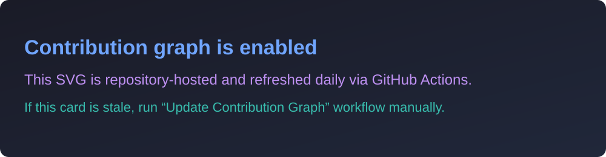

# Hi, I'm Pranav Raj 👋

### Final-Year Computer Science Student at IIT Mandi | Backend Engineering | Machine Learning

🎓 B.Tech. Computer Science · Expected Graduation: **2027**  
📍 India

  
  
  

---

## 👨‍💻 About Me

I am a final-year Computer Science student at the **Indian Institute of Technology, Mandi**, graduating in **2027**. I enjoy building backend systems, data-intensive applications, and machine learning solutions.

- 💻 Interested in software engineering, backend development, distributed systems, and machine learning
- 🧠 Strong foundation in data structures, algorithms, databases, operating systems, and computer networks
- 🧩 **500+ LeetCode** problems and **1000+ total** programming problems solved
- 🏆 LeetCode rating: **1717**, top **12.89%**

## 🛠️ Technologies and Tools

### Languages

  

### Backend, Frontend and Databases

  

### Cloud, DevOps and Development Tools

  

### Machine Learning and Data

  

  
  
  
  
  
  
  
  
  
  
  
  
  
  

---

## 🚀 Featured Projects

### 🔎 Multilingual Business Entity Resolution

**Amazon ML Challenge 2026 · Top 100 of 8000+ teams**

A multilingual entity-resolution pipeline processing **24.2M source records** and **1.73M test queries**.

- Combined dense retrieval, character-trigram TF-IDF, XGBoost scoring, and cross-encoder reranking.
- Achieved **0.987 macro F0.5** on the evaluation split.
- Implemented data-quality validation, grouped data splits, calibrated prediction routing, and performance analysis.

`Python` `XGBoost` `FAISS` `Transformers` `NLP` `TF-IDF`

<a href="https://github.com/Praj-0417/Amazon-ML-Challenge-2026">🔗 GitHub</a> · <a href="https://praj-0417.github.io/Amazon-ML-Challenge-2026/architecture.html">🌐 Architecture</a>

---

### ♻️ ScrapSaathi: AI-Powered Waste Management Platform

A waste-management platform built with a service-oriented architecture.

- Architected **5 microservices** behind an API gateway with JWT authentication, OTP verification, and RBAC across **4 user roles**.
- Implemented Redis rate limiting with HTTP 429 responses beyond **1,000 requests per 15 minutes**.
- Added Redis cache-aside with a **1-hour TTL**, reducing p95 latency by **90%** from **31 ms to 3 ms** at a **95%+ cache hit rate**.

`React` `Node.js` `Express.js` `MongoDB` `FastAPI` `FAISS` `Hugging Face` `RAG`

<a href="https://github.com/Praj-0417/ScrapSathi">🔗 GitHub</a> · <a href="https://scrap-sathi-lyart.vercel.app/">🌐 Live Demo</a>

---

### 🧠 Multi-Modal Brain Tumor Segmentation Pipeline

A three-stage medical-imaging pipeline combining YOLOv8m, LoRA-fine-tuned MedSAM, and nnU-Net.

- Achieved Dice scores of **0.76 on SSA** and **0.64 on Pediatric** unseen datasets.
- Outperformed SOTA by **33% and 42%** on the reported datasets.
- Used T1ce, T2, and FLAIR RGB-stacked volumes with **5 mm ROI masking** and LoRA fine-tuning.

`PyTorch` `YOLOv8` `MedSAM` `LoRA` `nnU-Net` `OpenCV`

<a href="https://github.com/Praj-0417/Brain_Tumor_segmentation">🔗 GitHub</a> · <a href="https://docs.google.com/presentation/d/1w_BFCxn8hc9H70to6h3_1vOmHWfLvOGO/edit?usp=sharing">📄 Report</a>

---

## 🏆 Achievements

  
  
  

- 🥇 **1st Prize**, KrackHack'24, GDSC IIT Mandi
- 🥈 **2nd Place**, HCL Deep Learning Hackathon among 60+ teams
- 🎯 **Top 100**, InMobi Codies 2026
- 🏅 **Top 10**, Chronos CTF, IIT Mandi
- 🎓 Academic Excellence Award by the Defence Minister for the highest departmental CGPA in first year

## 👥 Leadership

**Core Member, Kamand Prompt** — Led 3+ competitive programming contests and mentored **100+ students** in competitive programming and data structures.

---

## 📊 GitHub Statistics

  
  

  

  

## 📈 Contribution Activity

  

  If the graph image does not load, view my live contributions on
  <a href="https://github.com/Praj-0417">GitHub Profile Contributions</a>.

---

## 📫 Contact

- 📧 [pranavraj0105@gmail.com](mailto:pranavraj0105@gmail.com)
- 💼 [LinkedIn](https://www.linkedin.com/in/pranav-raj-705707212)
- 💻 [GitHub](https://github.com/Praj-0417)
- 🧠 [LeetCode](https://leetcode.com/Pranav_Raj_01/)
